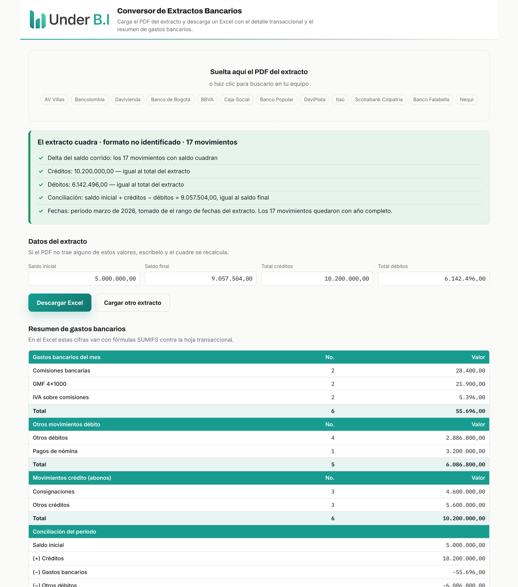
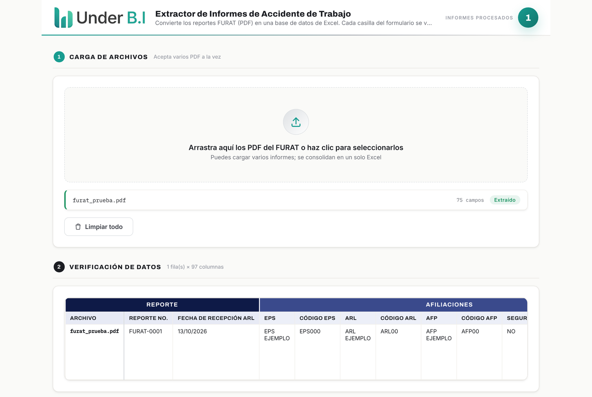
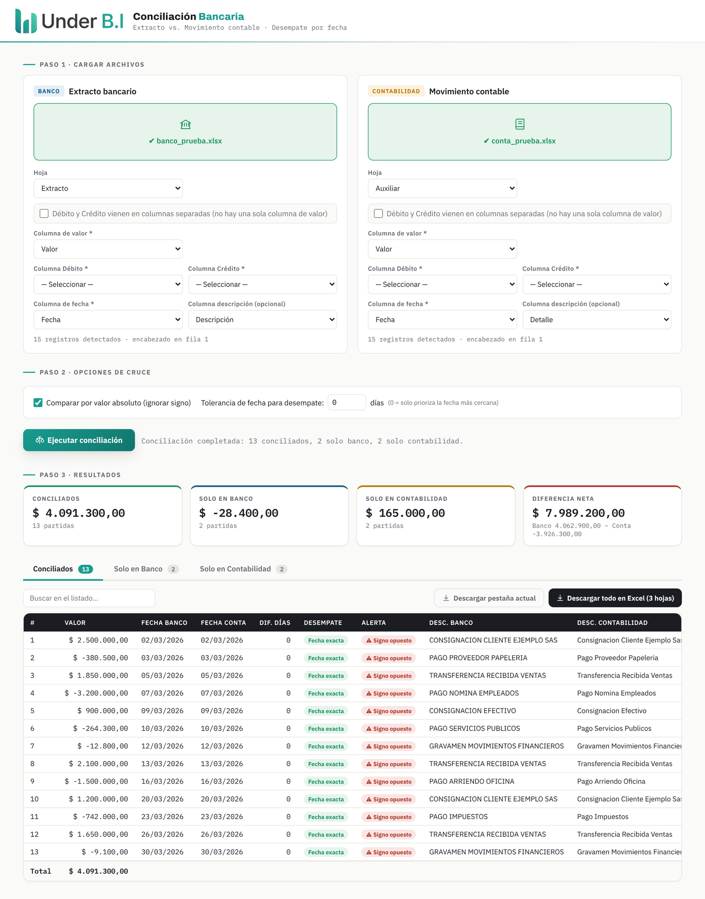
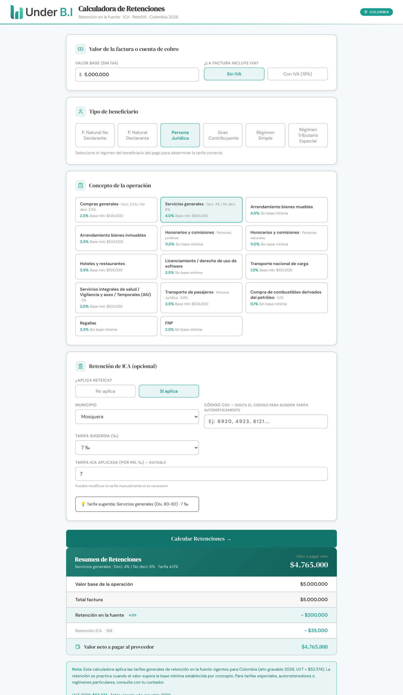
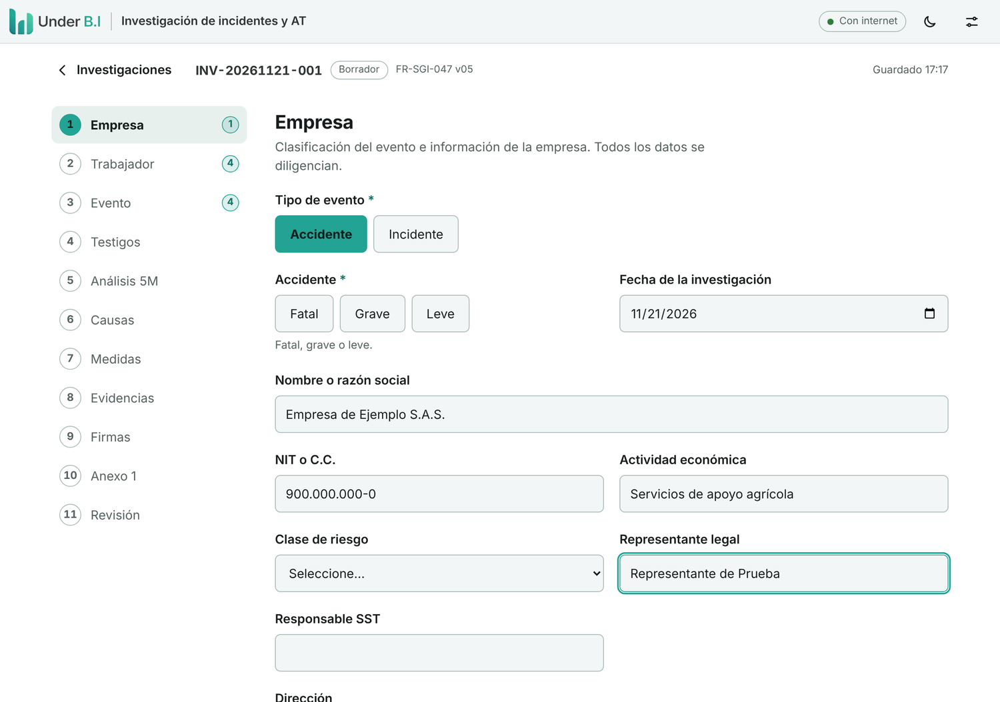
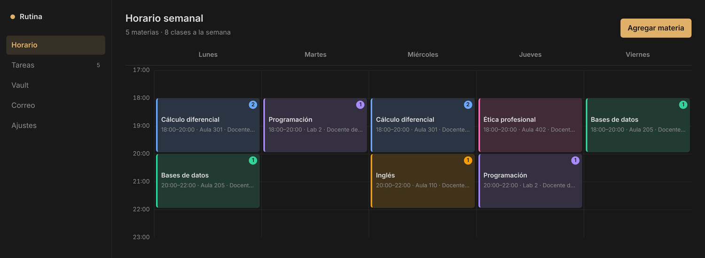

<h1 align="center">Hola, soy David Felipe Trejos Valencia 👋</h1>

  Estudiante de Ingeniería de Sistemas y desarrollador de software · Mosquera, Cundinamarca, Colombia

  
  

---

## Sobre mí

Estoy en quinto semestre de **Ingeniería de Sistemas** en la Corporación Tecnológica Industrial Colombiana. Desarrollo programas y aplicaciones que usan empresas reales en tareas **contables** y de **seguridad y salud en el trabajo**, además de páginas web y automatizaciones con Google Sheets.

Me interesa el software que resuelve un problema concreto, funciona sin complicaciones y cuida los datos de quien lo usa. Aprendo rápido por cuenta propia y trabajo de la mano con un contador para que lo que construyo respete el criterio contable.

## Tecnologías

**En aprendizaje:** FastAPI · PostgreSQL · React

## Cómo trabajo

- **Funciona sin internet.** Los programas instalados no dependen de la conexión, y lo verifico cortando las conexiones y contándolas.
- **Datos en el equipo del cliente.** Todo se procesa localmente y no guardo datos de los clientes.
- **Versiones claras.** Versionado desde la 1.0, con historial de cambios y decisiones documentadas.
- **Cuidado con lo sensible.** Repos privados, y nunca se versionan datos reales, llaves ni licencias. Antes de publicar reviso el contenido y busco secretos.
- **Criterio contable de un contador.** La lógica contable la define un contador; yo la convierto en software y la pruebo.

---

## Proyectos

Los programas hechos para clientes son privados por confidencialidad, así que aquí explico **qué hace cada uno, cómo está pensado y en qué estado está**. Las capturas usan datos inventados. Con gusto los muestro en una conversación.

### Conversor de extractos bancarios
Pasa el PDF de un extracto bancario a un Excel ordenado y comprueba que las cuentas cuadren. **Programa de escritorio · terminado (v1.0.1).** [Ver ficha →](proyectos/conversor-extractos.md)

### Extractor FURAT
Convierte informes de accidente de trabajo (FURAT, PDF) en una base de datos de Excel: cada casilla es una columna y cada informe, una fila. **Programa de escritorio · terminado (v1.0.1).** [Ver ficha →](proyectos/extractor-furat.md)

### Conciliación bancaria
Cruza el extracto del banco con la contabilidad y separa lo conciliado de lo que solo aparece en uno de los dos. **Programa de escritorio · terminado (v1.0.1).** [Ver ficha →](proyectos/conciliacion-bancaria.md)

### Calculadora de retenciones
Calcula retención en la fuente, ReteICA y ReteIVA con las tarifas de 2026. **Programa de escritorio · terminado (v1.0.1).** [Ver ficha →](proyectos/calculadora-retenciones.md)

### Investigación de incidentes y accidentes (SST)
Formato de investigación que se diligencia desde el celular o el computador, con dictado por voz, fotos y firma, aun sin internet. **Aplicación web instalable (PWA) · en pruebas.** [Ver ficha →](proyectos/incidentes-sst.md)

### Rutina
App personal para organizar mi horario, mis tareas y mis recordatorios de estudiante. **Programa de escritorio · en uso diario.** [Ver ficha →](proyectos/rutina.md)

### Otros proyectos
- [Licencias y principios de producto](proyectos/licencias-y-principios.md): cómo controlo el acceso a los programas y las reglas con las que los construyo.
- [Venta de boletas automatizada](proyectos/automatizacion-boletas.md): venta de boletas y envío automático de correos con Google Sheets, para la Fundación APUCS.
- [Páginas web](proyectos/paginas-web.md): sitios tipo catálogo y de contacto para negocios.

---

## Contacto

📍 Mosquera, Cundinamarca, Colombia · ✉️ [dafetreva@gmail.com](mailto:dafetreva@gmail.com) · 💼 [LinkedIn](https://www.linkedin.com/in/david-trejos-valencia/)
