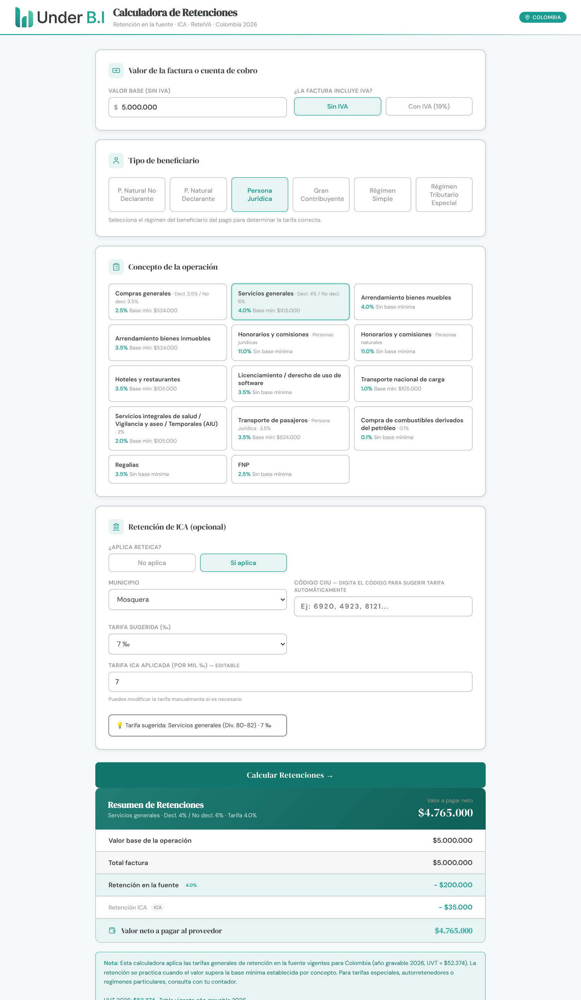

# Calculadora de retenciones

_Captura con datos de prueba._

**Tipo:** programa de escritorio para Windows · **Estado:** terminado (v1.0.1) · **Stack:** Electron, HTML/CSS/JavaScript

## Qué hace
Calcula la **retención en la fuente, ReteICA y ReteIVA** con las tarifas y la UVT de 2026. Para ReteICA cubre Bogotá, Chía, Facatativá, Funza, Madrid y Mosquera, y sugiere la tarifa a partir del código de actividad económica (CIIU). Contempla el régimen simple.

## Qué hice yo y qué no
La lógica de cálculo es de un contador y **no se modifica sin su visto bueno**: cuando rediseñé la pantalla, comprobé con una huella (hash) que el script de cálculo quedó idéntico al original. Mi trabajo fue convertirla en un programa de escritorio instalable, con licencia, interfaz renovada, íconos de línea en lugar de emojis y fuentes incluidas para que no dependa de internet. También detecté que el texto de un botón era casi invisible sobre uno de los colores de marca (contraste 1.19) y lo corregí.

## Mantenimiento
Cada enero hay que actualizar la UVT y las tarifas de retención.
