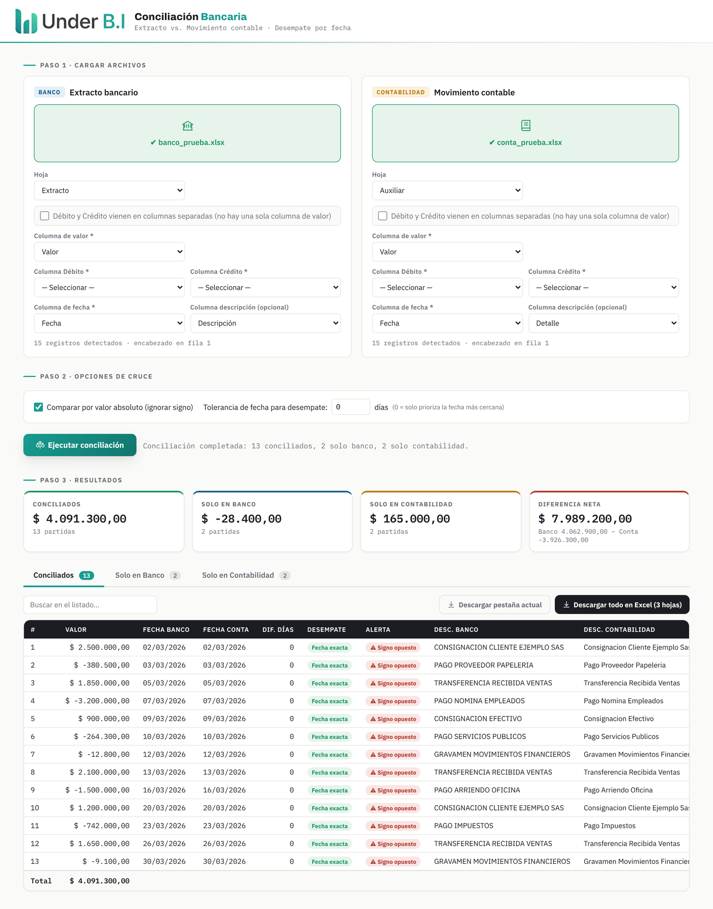

# Conciliación bancaria

_Captura con datos de prueba._

**Tipo:** programa de escritorio para Windows · **Estado:** terminado (v1.0.1) · **Stack:** Electron, JavaScript, SheetJS

## Qué problema resuelve
Conciliar es comparar lo que dice el banco con lo que dice la contabilidad. Hecho a mano, es lento y es fácil que se escape una diferencia.

## Qué hace
Recibe dos archivos de Excel, el **extracto bancario** y el **movimiento contable**, y separa el resultado en tres hojas: **Conciliados**, **Solo banco** y **Solo contabilidad**. Detecta solo las columnas, acepta el valor en una columna o en columnas de débito y crédito, y permite comparar por valor absoluto y usar una tolerancia de fecha para desempatar.

El banco y la contabilidad registran en sentido opuesto (partida doble), y el programa lo respeta.

## Cómo está armado
Es el programa con arquitectura modular: siete módulos separados (lectura, estado, Excel, conciliador, vista, exportación y aplicación). La lógica de negocio queda aislada de la marca y de la interfaz.

## Errores que encontré y corregí
Desfase de zona horaria en las fechas; errores de punto flotante en los valores (ahora todo se calcula en **centavos enteros**); resultados que quedaban viejos al cambiar una opción; exportaciones que ignoraban el filtro activo; y filas con valor cero que se excluían en silencio. Documenté las correcciones en un informe explicado en términos contables para el contador.

## Estado
Validado con archivos reales de un mes de un banco, y con archivos de prueba de datos inventados. Funciona sin internet.
