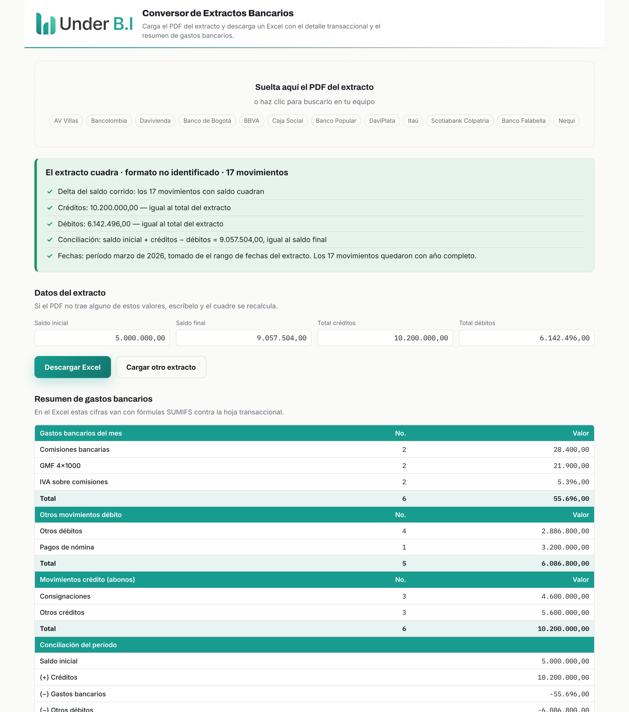

# Conversor de extractos bancarios

_Captura con datos de prueba._

**Tipo:** programa de escritorio para Windows · **Estado:** terminado (v1.0.1) · **Stack:** Electron, JavaScript, pdf.js, ExcelJS

## Qué problema resuelve
Los bancos entregan el extracto en PDF. Para contabilidad, alguien tiene que pasar cada movimiento a una hoja de cálculo, uno por uno, y después comprobar que los números cuadren.

## Qué hace
Lee el PDF, detecta de qué banco es y extrae cada movimiento (fecha, descripción, valor y saldo). Los clasifica (comisiones, IVA, GMF y demás gastos bancarios) y genera un Excel con dos hojas: **Transaccional**, un movimiento por fila, y **Resumen de gastos bancarios**.

Antes de descargar muestra un panel de verificación que dice **"El extracto cuadra"** solo si se cumplen las cuentas: saldo inicial + créditos − débitos = saldo final, los totales coinciden con los del banco y el saldo corrido cuadra movimiento a movimiento.

## Problemas interesantes que resolví
- **Fechas sin año.** Varios bancos imprimen `15/07`. El programa busca el período del extracto por seis vías, de la más a la menos confiable, y si no lo encuentra lo infiere de los propios movimientos. Un extracto de enero con movimientos de diciembre recibe el año anterior.
- **Fechas reales en Excel.** Se exportan como fecha de Excel y no como texto, porque si no los filtros y las fórmulas por fecha fallan sin avisar.
- **Clasificar con sentido.** Una regla solo aplica si coincide con el sentido del movimiento (un crédito nunca se cuenta como gasto), porque si no el extracto dejaba de cuadrar.
- **Un lector que fallaba.** En un banco, el programa encontraba 1 de 284 movimientos porque el número de movimiento tenía cinco dígitos. Lo corregí y desde entonces el extracto cuadra al centavo.

## Estado y alcance
Reconoce 12 bancos colombianos y tiene un modo genérico. Está validado de punta a punta con extractos reales de dos bancos; los demás están reconocidos y pendientes de validar con extractos reales. Funciona sin internet.
