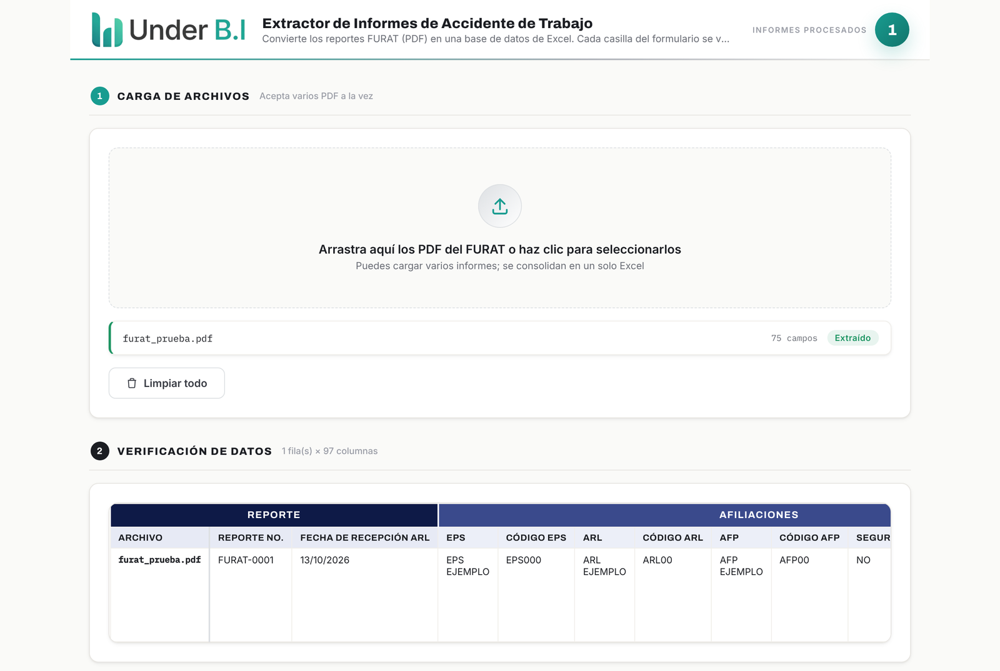

# Extractor FURAT

_Capturas con datos de prueba._

**Tipo:** programa de escritorio para Windows · **Estado:** terminado (v1.0.1) · **Stack:** Electron, JavaScript, pdf.js, ExcelJS

## Qué problema resuelve
Los informes de accidente de trabajo (formato FURAT) llegan como PDF individuales. Para llevar un control o hacer reportes hay que pasar los datos de cada casilla a mano.

## Qué hace
Convierte los informes FURAT en una base de datos de Excel: **cada casilla del formulario es una columna y cada informe, una fila**. Acepta varios PDF a la vez y los consolida en un solo archivo (hojas FURAT y RESUMEN), con una pantalla para revisar los datos antes de descargar. Si el PDF no es un FURAT, lo avisa en lugar de inventar datos.

## Cómo está pensado
La extracción está calibrada para el formato de una aseguradora de riesgos laborales. Si esa plantilla cambia, hay que recalibrar. Es el programa más pequeño de la suite y funciona sin internet.

## Estado
Probado con PDF de prueba y con documentos que no son FURAT (los rechaza correctamente). Queda pendiente validarlo con más informes reales.
