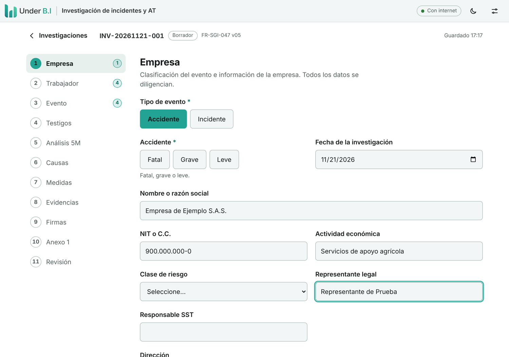
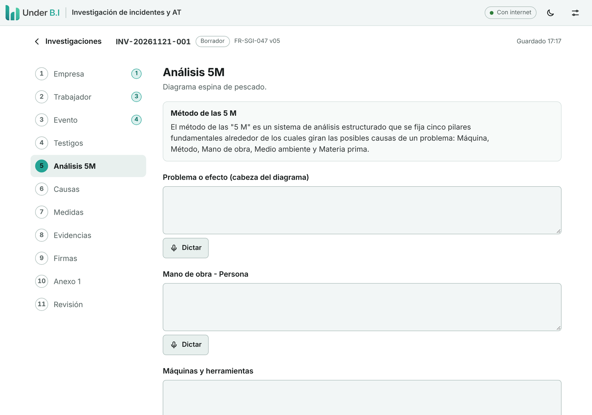
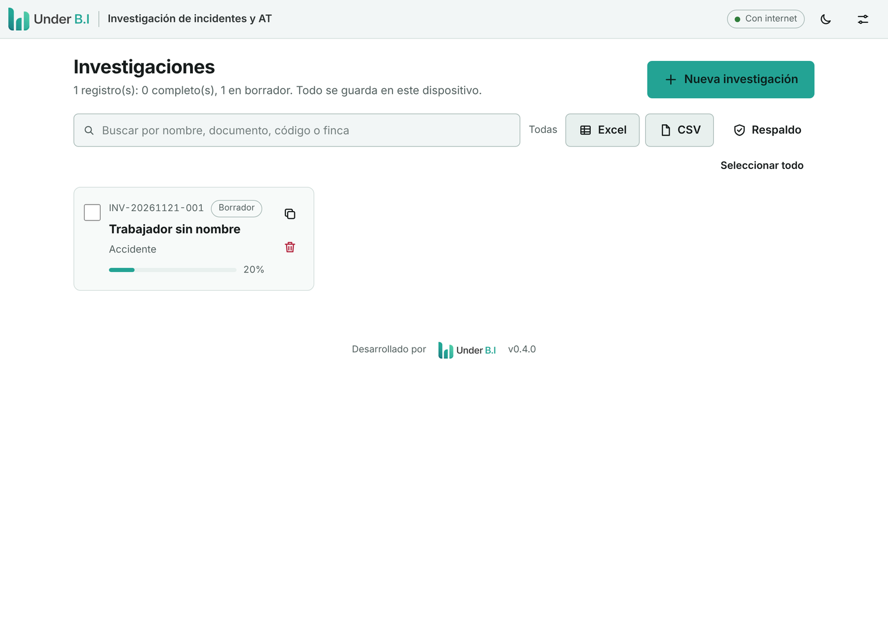

# Investigación de incidentes y accidentes de trabajo (SST)

_Captura con datos de prueba._

**Tipo:** aplicación web instalable (PWA) · **Estado:** en pruebas (v1.2.1) · **Stack:** JavaScript sin framework, ExcelJS, JSZip, esbuild · pruebas con Node, jsdom y fake-indexeddb

## Qué problema resuelve
Investigar un incidente o accidente de trabajo implica llenar un formato largo (FR-SGI-047), muchas veces en fincas y zonas rurales donde el internet es inestable o no hay. Llevarlo en papel y pasarlo después al computador es lento y se pierde información.

## Qué hace
Una aplicación que se usa en **celular y computador, aun sin internet**, para diligenciar el formato:
- Formulario en 10 pasos más una revisión, con autoguardado, listas y filas repetibles.
- Dictado por voz, fotos y videos, ubicación GPS y firma en pantalla.
- Un contador del **plazo de 15 días** para investigar, calculado desde la fecha del evento.
- Salida en **Word** (sobre la plantilla oficial, sin agregarle nada), **Excel** (con las evidencias) y **CSV**, además de respaldos con restauración.

## Decisiones que tomé
- **Los datos se quedan en el dispositivo.** Las investigaciones llevan datos personales y de salud, así que nunca viajan a un servidor.
- **El formulario está definido por datos.** Cambiar el formato es editar un archivo; la pantalla, el Excel y la validación se adaptan.
- **El Word no lleva añadidos.** El formato no es mío para modificarlo, así que las evidencias van en el Excel.
- **Acceso solo por invitación**, y la app instalada sigue funcionando sin conexión.

## Límites que conozco
El dictado por voz usa el servicio de reconocimiento del navegador, así que no es 100 % offline. Exportar con muchos videos grandes conviene hacerlo por lotes.
