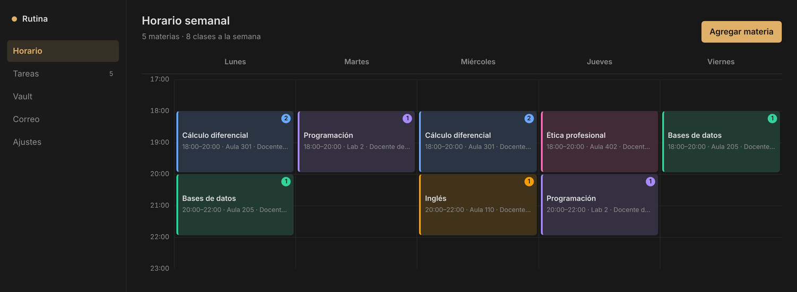
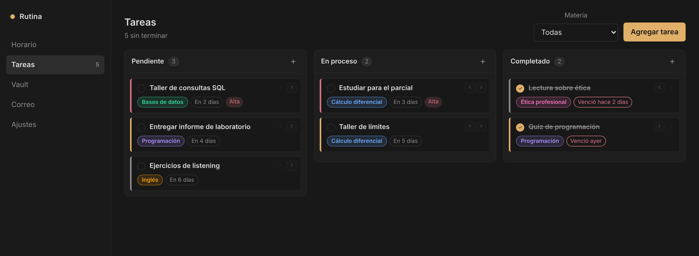

# Rutina

_Capturas con datos de prueba._

**Tipo:** programa de escritorio para Windows, proyecto personal · **Estado:** en uso diario desde hace meses · **Stack:** Electron, Node.js, HTML/CSS/JavaScript

## Qué es
Una app para organizar mi vida de estudiante: **horario semanal**, **tablero de tareas** (Pendiente, En proceso y Completado), tareas ligadas a cada materia y **recordatorios en segundo plano**. Funciona sin internet y la uso a diario, entre mi computador de escritorio y mi portátil.

## Cómo está pensada
- **Sin base de datos ni servidor.** Los datos viven en un archivo JSON y la lógica de datos está separada de la interfaz. Se sincronizan entre dos computadores con una carpeta compartida.
- **Datos seguros.** Escritura atómica del archivo, relectura antes de guardar y migraciones de versión en cadena para no perder información al actualizar.
- **Tres capas separadas** (proceso principal, puente seguro y pantalla) que se comunican por mensajes.
- **Pruebas** de la capa de datos (migraciones, avisos, franja de silencio, entre otras).
- **Estética propia:** oscura por defecto, con modo claro.

## Lo que sigue creciendo
Ya incluye una pestaña que muestra los pendientes de mis notas de proyectos y los marca desde la app, y otra con los correos importantes de la universidad agrupados por materia.

El código es privado por ahora. Con gusto lo muestro y lo explico.
